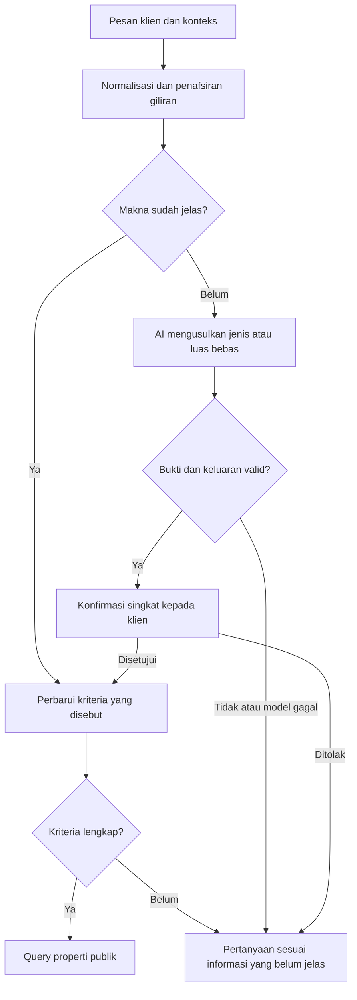

# Pemahaman percakapan — 13 Oktober 2026

Versi aktif di kode: `2026-10-13-multi-category-v3`. Pengembangan daftar jenis
dan hasil uji terbaru dicatat di [pencarian beberapa jenis](multi-category-search.md).

## Masalah dan perubahan

Sebelumnya, kualifikasi pencarian langsung memakai parser dan template; model
AI untuk balasan tidak ikut membantu memahami jawaban yang gagal diparsing.
Selain masalah “rumah dan toko”, penambahan jenis sering mengganti seluruh
pilihan, penolakan belum menghapus jenis, dan koreksi angka bisa mengambil
nominal yang justru ditolak. Pertanyaan tentang istilah juga bisa mengubah
filter karena mengandung nama jenis properti.

Sekarang ada tiga tahap:

1. Normalisasi bahasa dan penafsiran giliran: singkatan yang dikenal, angka
   tertulis, pertanyaan penjelasan, konfirmasi, dan jawaban lanjutan tentang luas.
2. Perubahan kriteria: mengganti, menambah, menghapus, atau membebaskan pilihan.
   Lokasi, budget, dan bidang lain tetap mengikuti informasi klien sebelumnya.
   Menghapus semua jenis membuat jenis belum terjawab; itu tidak berarti bebas.
3. Pemilihan tindakan: menjelaskan istilah, meminta hanya informasi yang belum
   jelas, meminta konfirmasi tafsiran, atau mencari dengan filter tervalidasi.



`buyer_turn.js` menangani tindakan percakapan. `property_category.js` mengelola
perubahan daftar jenis; `buyer_profile.js` menyusun kriteria dari riwayat.
`buyer_interpreter.js` meminta JSON terstruktur dari provider yang dikonfigurasi.
`llm_transport.js` dipakai bersama oleh pemahaman dan jawaban AI, termasuk
validasi keluaran, pembatalan, perpindahan model, dan penundaan ketika kuota habis.
WhatsApp dan Playground memakai alur balasan yang sama.

## Contoh perilaku

Konteks seluruh contoh: Kecamatan Menganti, Kabupaten Gresik, maksimal Rp400 juta.

| Jawaban klien | Perilaku |
| --- | --- |
| “rumah dan toko pak. tidak ada batasan luasan” | Cari RUMAH atau TOKO; luas bebas. |
| “rumah pak”, kemudian “toko juga boleh” | Tambahkan TOKO tanpa menghapus RUMAH. |
| “hapus toko dari pilihan” | Hapus TOKO; kriteria lain tetap. |
| “budget bukan 400 juta, tapi 350 juta” | Maksimal Rp350 juta. |
| “budget jangan di atas 350 juta” | Batas maksimal, bukan minimal. |
| “rumah dan toko, 120m2”, kemudian “minimal pak” | Klarifikasi arah ukuran, lalu simpan minimal 120 m². |
| “jenis sama luas dua-duanya bebas” | Bebaskan jenis dan luas; lokasi serta budget tetap. |
| “apa bedanya rumah dan ruko?” | Jelaskan perbedaannya; jangan mengganti filter. |
| “luas belum tau” | Pertahankan kriteria lain dan klarifikasi luas. |
| “Buat tempat tinggal ataupun buka warung pak, soal ukuran jangan dipikirin” | AI mengusulkan RUMAH atau TOKO dan luas bebas; minta persetujuan. |

Pada contoh terakhir, keluaran aktual model dirender menjadi:

> Apakah maksud Bapak/Ibu: jenis rumah atau toko; luas tanah bebas?

Jawaban “iya betul pak” menerapkan kriteria itu. “Bukan itu” tidak menerapkannya.
Jawaban “iya, luas minimal 150m2” menyetujui jenis sambil memberi batas luas baru.
Harga, lokasi, dan fakta properti tidak dibuat oleh lapisan tafsiran ini.

## Pengujian pengembangan awal (v2)

| Pengujian | Sebelum pengembangan ini | Hasil akhir |
| --- | ---: | ---: |
| 24 skenario perubahan kriteria dan percakapan | 7/24 | 24/24 |
| 500 variasi bahasa tambahan, seed `20261013` | 310/500 | 500/500 |
| Total corpus tambahan | 317/524 (60,50%) | 524/524 |
| Corpus sebelumnya | — | 515/515 |
| Seluruh tes backend | — | 456/456 |
| Lima contoh dengan konfigurasi Gemini | 3/5 pada percobaan awal | 5/5 pada percobaan akhir |

Percobaan terakhir menggunakan Gemini `gemini-2.5-flash` sungguhan: empat
contoh melalui model, satu dipahami langsung oleh aturan setelah perbaikan alias
“indekos” dan pemisahan kata tanah dari preferensi ukuran. Tidak ada akses ke
database produksi atau pengiriman WhatsApp. Contoh ini dipakai juga untuk
memperbaiki implementasi; hasilnya bukan evaluasi independen.

Tes mencakup HTTP Playground, proses WhatsApp tiruan, filter Prisma, persetujuan,
penolakan, jawaban terpisah, gabungan pertanyaan/jawaban, negasi angka, schema
provider OpenAI/Gemini, bukti yang tidak valid, JSON rusak, keluaran terpotong,
kuota habis, pembatalan, dan penanda versi pada endpoint kesehatan.

Proporsi keberhasilan pada generator sintetis adalah 100%; interval Wilson 95%
untuk 500 sampel acak tambahan adalah 99,24–100%. Ini hanya statistik sampling
generator tersebut. Frasa dan kombinasi bisa berulang, dan corpus digunakan
saat pengembangan. Angka ini **bukan probabilitas memahami seluruh percakapan
pelanggan**. Lima percobaan model juga terlalu sedikit untuk klaim akurasi umum.

## Batas implementasi

- AI tambahan hanya mengusulkan jenis dan luas tanpa batas yang belum jelas.
  Angka, lokasi, properti publik, dan batas query tetap divalidasi backend.
- Tafsiran AI tidak langsung menjadi filter; persetujuan klien diperlukan.
- Kata yang jelas, koreksi, dan jawaban biasa diproses tanpa model tambahan.
  Jalur bantuan model memiliki batas waktu total delapan detik.
- Riwayat tetap mengikuti batas memori aplikasi (maksimal 24 pesan/12 giliran
  pengguna, dengan reset saat idle). Ini tidak menambahkan memori permanen.
- Kegagalan model tetap menghasilkan klarifikasi lokal, tanpa melonggarkan
  kriteria atau mengarang hasil pencarian.

## Menjalankan dan memastikan versi aktif

Dari `backend/whatsapp`:

```sh
npm run check
npm run simulate:understanding
npm run simulate:language
```

Percobaan berikut memanggil provider AI dengan konfigurasi `.env` dan memakai
kuota provider, tanpa mengirim WhatsApp:

```sh
npm run simulate:understanding:ai
```

Transkrip lengkap tersedia pada sesi ini:

- `/tmp/kosku-understanding-baseline.json`
- `/tmp/kosku-understanding-simulations.json`
- `/tmp/kosku-language-simulations.json`
- `/tmp/kosku-understanding-ai-initial.json`
- `/tmp/kosku-understanding-ai.json`
- `/tmp/kosku-understanding-check.log`

File `/tmp` bersifat sementara. Angka dan perilaku utama dicatat di dokumen ini.

Perbaikan berada di workspace. Pemeriksaan loopback menemukan tidak ada backend
yang mendengarkan pada `127.0.0.1:3100` saat pengujian. Lokasi layanan WhatsApp
yang menghasilkan contoh pengguna belum diketahui, sehingga versi aktifnya
belum dapat diverifikasi dan tidak ada deployment/restart produksi dilakukan.

Sesudah memperbarui backend di host yang digunakan dan merestart prosesnya,
periksa `GET /health`: field `understanding_version` harus bernilai
`2026-10-13-multi-category-v3`. Backend memakai `npm start` memerlukan restart agar
memuat perubahan file; restart Next.js saja tidak memperbarui proses WhatsApp.
API Next.js juga harus sudah mendukung `criteria.categories` dari perbaikan
sebelumnya. Halaman Playground memakai backend yang sama melalui koneksi server.
